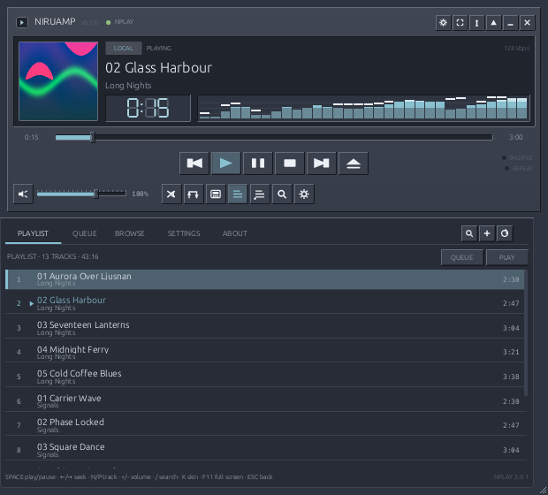
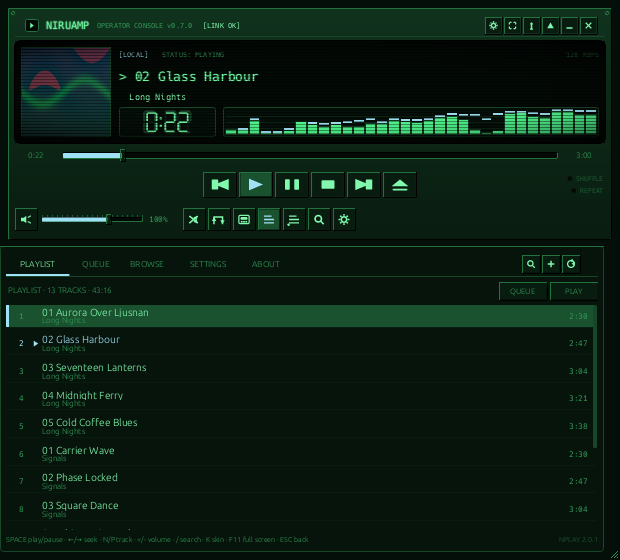
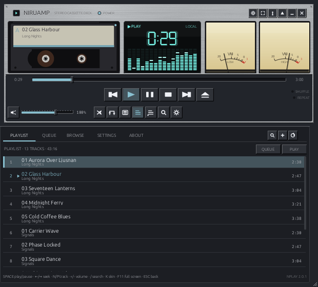

# NIRUAMP

Winamp-inspired graphical frontend for NPLAY, written in Rust.

**Status: alpha** · Part of the [NIRUX](https://github.com/nirucon/nirux) suite · [MIT License](LICENSE)



| Phosphor | Hi-Fi Deck |
|---|---|
|  |  |

More screenshots: [light theme](docs/screenshots/main-light.png),
[search](docs/screenshots/search.png), [settings](docs/screenshots/settings.png),
[windowshade](docs/screenshots/windowshade.png).

## About

NIRUAMP is the classic, compact player window I missed: a hardware-panel deck,
LED time, spectrum display and a dense playlist, in the spirit of Winamp but
with original vector artwork and live NIRUX theming. Three original skins
(Classic, Phosphor and Hi-Fi Deck) all take their colours from the current
theme. It is not affiliated with Winamp.

**NIRUAMP is a frontend only and cannot run without
[NPLAY](https://github.com/nirucon/nplay).** NPLAY owns playback, queue,
providers, library, statistics, notifications and MPRIS; NIRUAMP talks to
NPLAY's local control service over a private Unix socket. NPLAY remains a
complete standalone terminal player with or without NIRUAMP and NIRUX.

NIRUAMP is a small X11 program: it runs in the NIRUX session (NIRUWM) and,
through XWayland, on Wayland desktops such as Omarchy/Hyprland. Since 0.6 it
draws with its own software canvas (x11rb, tiny-skia, MIT-SHM) instead of
egui and OpenGL: about 8 MB of memory instead of 120 MB, a first frame in
about 15 ms, and no CPU at all while nothing changes.

## Features

- Winamp-style deck: LED clock, seek and volume, transport, shuffle/repeat
  lamps, attached playlist and queue panels, windowshade mode,
  always-on-top, a compact title bar and remembered geometry.
- Three skins, switched with `K`, the skin button or Settings and
  remembered: **Classic** (the hardware panel), **Phosphor** (a green CRT
  operator console with scanlines and a glowing seven-segment clock) and
  **Hi-Fi Deck** (a brushed-metal cassette deck with a tape window, a VFD
  analyser and two analogue VU meters). All three follow the theme's accent
  and foreground, and are drawn in code: no bitmaps from other products.
- Fullscreen visual mode (`F11`): black screen, centred track, artist and
  album, themed CAVA bars and progress.
- Real CAVA visualization at up to 30 fps (30/20/15 in Settings), pushed by
  NPLAY 1.8's visualization stream; it pauses (and NPLAY stops CAVA) while
  the window is hidden, covered, minimized or in the tray. Levels are shown
  on a decibel scale around a slowly adapting reference, so quiet and loud
  masters both fill the display without pinning at the top; bars fall with
  gravity and leave short-lived peak caps. No fake bars: a clear
  "unavailable" state otherwise.
- Async federated search across local music, Navidrome, Sveriges Radio,
  YouTube, Spotify and custom radio, with stale-result protection.
- Browse artists, albums, folders, playlists, favorites, history, radio,
  provider albums/playlists/artists and Spotify devices.
- Queue play/add/remove/drag-reorder/clear/save, local playlists, favorites,
  ratings, custom radio, and drag-and-drop of local media and streams.
  Containers (albums, playlists, folders) always resolve to playable tracks.
- Optional theme-aware tray icon (StatusNotifierItem): minimize to tray,
  menu, middle-click play/pause, scroll for volume.
- Theme **Auto**: follows NIRUX in the NIRUX session and Omarchy elsewhere,
  live; NIRUAMP Classic as the standalone fallback.
- Frugal: one frame scheduler, only the changed part of the window is
  redrawn, nothing at all while idle or hidden, no polling threads; measured
  below and in [docs/VALIDATION.md](docs/VALIDATION.md).
- A short welcome sound on the first start after login, at 35 % by default
  (Settings: off, 20, 35, 50, 75 or 100 %); later starts in the same login
  are silent.

## Requirements

- Linux, x86_64, an X11 display (XWayland on Wayland desktops). Verified on
  Debian 13 with NIRUX; Omarchy 4 (Hyprland) through XWayland.
- **NPLAY 1.7.3 or newer** with its prerequisites (`mpv`, Python 3).
  NPLAY 1.8.0+ is recommended (visualization stream instead of polling, about
  a third of NPLAY's CPU), and 1.8.1+ adds **Settings → Sources → Spotify →
  AUTHORIZE LOCAL**.
- The prebuilt binary is static (musl): no glibc version, GL, EGL or
  xkbcommon libraries are needed. Building from source needs Rust 1.85+.
- Optional: `cava` (visualization), `yt-dlp`, `librespot`, Navidrome
  credentials, Spotify Premium, a StatusNotifierItem tray host.

## Installation

### With NIRUX

NIRUAMP is an optional extra, not part of a normal `nirux install`:

```sh
nirux extras install niruamp
nirux extras update            # later: update selected extras to the pinned version
```

This installs or updates the pinned NPLAY first, then NIRUAMP. In NIRUX,
`nirux manual niruamp` opens the short tour in the NIRUX manual.

### Standalone

Install NPLAY first, then:

```sh
git clone https://github.com/nirucon/niruamp.git
cd niruamp
./install.sh
niruamp
```

The installer refuses to continue when NPLAY is missing or older than 1.7.3
(`NIRUAMP_SKIP_NPLAY_CHECK=1` skips that, for packaging experiments only). It
downloads the published x86_64 release binary when possible and builds with
cargo otherwise, then installs `~/.local/bin/niruamp`, a desktop entry and an
icon. The downloaded binary is checked against the release's `SHA256SUMS`.

```sh
./install.sh --prebuilt  # only the published, verified binary
./install.sh --source    # always build with cargo (also --build)
```

Manual install of the release binary:

```sh
sha256sum -c --ignore-missing SHA256SUMS
install -m755 niruamp ~/.local/bin/niruamp
```

On Omarchy/Arch the steps are the same; see [docs/WAYLAND.md](docs/WAYLAND.md).

## Usage

```sh
niruamp                  # start, or activate the running window
niruamp --class NAME     # another WM_CLASS (default: niruamp)
niruamp --version
niruamp --help
```

NIRUAMP connects to `$XDG_RUNTIME_DIR/nplay/control.sock` and starts the
installed `nplay --serve` itself when no compatible service is running. A GUI
never stops a service it did not start; a service it started stops on normal
exit unless **Keep playing after GUI exit** is on (applies to the next service
launch). You can also run the backend by hand:

```sh
nplay --serve
nplay --serve --service-socket /path/to/socket --idle-exit 25
```

| Key | Action |
|---|---|
| `Space` | Play / pause |
| `N` / `P` | Next / previous |
| `S` | Stop |
| `Left` / `Right` | Seek 5 s (`Shift`: 30 s) |
| `+` / `-` / `M` | Volume / mute |
| `R` / `H` | Repeat / shuffle |
| `V` | Visualization on / off |
| `K` | Next skin (Classic, Phosphor, Hi-Fi Deck) |
| `/` or `Ctrl+F` | Search |
| `B` | Browse |
| `F` | Favorite the current track |
| `1` … `5` | Playlist / queue / browse / settings / about |
| `W` / `T` | Windowshade / always-on-top |
| `F11` | Fullscreen visual mode (`Esc` or `F11` leaves it) |
| `Tab` / `Shift+Tab`, `Enter` | Move focus, activate the focused control |
| `Up` / `Down` | Move selection |
| `Alt+Up` / `Alt+Down` | Reorder the queue |
| `Delete` | Remove the selected queue item |
| `Esc` | Back / leave a text field |

Shortcuts never steal typing from text fields. Right-click a track for queue,
playlist, favorite and detail actions. Drag local media onto the window to
play it; extra files are queued. Minimize hides to the tray when a tray host
exists; left-click the tray icon to restore.

## Configuration

Settings are changed in the app (`4` or the settings tab) and saved to
`~/.config/niruamp/config.toml`: theme, skin, scale, always-on-top, keep
playing, visualization on/off and frame rate, pausing the hidden
visualization, the welcome sound and its level, tray, reduced motion,
remaining time, and the `nplay_bin` to start (the NPLAY executable, default
`nplay`). [config.example.toml](config.example.toml) lists every key with
its default.

| Key | Default | Meaning |
|---|---|---|
| `skin` | `"classic"` | `classic`, `phosphor` or `hifi` |
| `startup_sound` | `true` | Play the welcome sound on the first start after login |
| `startup_sound_volume` | `35` | Its level, percent of full scale (1 to 100) |

The welcome sound remembers that it has played in
`$XDG_RUNTIME_DIR/niruamp/welcome-played`, which goes away at logout. It is
played by `pw-play`, `paplay`, `ffplay` or `mpv`, whichever is found first,
at the same loudness in each (`paplay` and `mpv` use a cubic volume scale and
get the matching value).

With **Theme → Auto** the palette comes from NIRUX (`~/.config/niruwm/config.toml`,
custom `~/.config/niruwm/themes/NAME.toml`, `appearance.toml` overrides) or,
outside the NIRUX session, the current Omarchy theme. The full resolution
order is in [docs/WAYLAND.md](docs/WAYLAND.md#theme-resolution).

Environment variables:

| Variable | Effect |
|---|---|
| `NPLAY_SERVICE_SOCKET=PATH` | Connect to an existing NPLAY control socket |
| `NPLAY_DEV_PATH=/path/to/nplay` | Use an NPLAY source checkout instead of the installed one |
| `NIRUAMP_SKIP_STARTUP_SOUND` | Never play the welcome sound (any value) |
| `NIRUAMP_DEBUG_FPS` | Print frames/s, NPLAY messages/s and repainted pixels every 5 s |
| `NIRUAMP_TIMING` | Print the time to the first frame |
| `NIRUAMP_SCREENSHOT=PATH` | Save a PNG of the window (`NIRUAMP_SCREENSHOT_DELAY` seconds after start) |
| `NIRUAMP_NO_SHM` | Present with `PutImage` instead of MIT-SHM |

## Files and paths

| Path | Purpose |
|---|---|
| `~/.local/bin/niruamp` | The binary |
| `~/.local/share/applications/niruamp.desktop` | Desktop entry |
| `~/.local/share/icons/hicolor/scalable/apps/niruamp.svg` | Icon |
| `~/.config/niruamp/config.toml` | Preferences |
| `~/.local/state/niruamp/window.toml` | Window geometry and state |
| `$XDG_RUNTIME_DIR/niruamp/welcome-played` | The welcome sound has played in this login |
| `$XDG_RUNTIME_DIR/nplay/control.sock` | NPLAY control service socket |

Navidrome and Spotify credentials stay in NPLAY's `0600` secrets file; NIRUAMP
never reads or displays them.

## Troubleshooting

- **"NPLAY is missing or too old".** Install or update NPLAY (1.7.3+); with
  NIRUX, `nirux extras install niruamp` does it for you.
- **No spectrum.** Install `cava`. Visualization depends on what CAVA can
  capture from your audio setup; live radio and YouTube depend on that too.
- **No tray icon.** Tray support needs a StatusNotifierItem host; without one,
  minimize gives a normal minimized window.
- **Position or always-on-top is not kept on a Wayland desktop.** NIRUAMP
  runs through XWayland there; Hyprland is asked directly (floating rule,
  pin, tray workspace), other compositors decide placement themselves.
  Details in [docs/WAYLAND.md](docs/WAYLAND.md).

Known limits:

- No equalizer (NPLAY has no EQ DSP for mpv, and Spotify does not go through
  mpv), and no `.wsz` skins: the three built-in skins are drawn in code.
- CAVA's output is mono, so the Hi-Fi Deck's two VU meters show the low and
  high halves of the spectrum, not left and right.
- Live radio cannot seek; some source-specific operations are backend limits
  and show as disabled.

## Performance

Measured on othala in a private Xvfb with a sandboxed NPLAY 1.8.2 (fake mpv
and CAVA harness, 30 fps spectrum), `tests/xvfb.sh` and a sampling script:

| | 0.5.2 (egui, OpenGL) | 0.6.0 (x11rb canvas) |
|---|---|---|
| Window shown after start | 118 ms | 28 ms (first frame 13 to 17 ms) |
| Memory (RSS) | 120 MB | 8 MB |
| Threads | 33 | 6 (8 with the tray) |
| CPU, stopped or paused without spectrum | 0 % | 0 % |
| CPU, playing with the spectrum | 305 % (llvmpipe in Xvfb) | 2 to 3 % |
| CPU, window on another workspace | 0 % | 0 % |

On real hardware 0.5.2 measured 124 MB, about 85 MB of it GL mappings.

0.7.0 per skin, measured in a private Xvfb with NPLAY 2.0.1 and real CAVA
fed by a test track (30 fps spectrum, one core):

| | Classic | Phosphor | Hi-Fi Deck |
|---|---|---|---|
| CPU, playing with the spectrum | 3.6 to 3.9 % (0.6.0: 3.9 to 4.0 %) | 5.8 % | 7.5 % |
| CPU, paused, silent or hidden | 0 % | 0 % | 0 % |
| Memory (RSS) | 11 MB | 11 MB | 13 MB |

Only the parts that moved are repainted (the bars, the needles, the reels);
the skin textures are generated once per size.

## Uninstall

With NIRUX: `nirux extras uninstall niruamp` runs the uninstaller below from the pinned release (add `--purge` to pass it on).

```sh
./uninstall.sh          # keeps NIRUAMP preferences and all NPLAY data
./uninstall.sh --purge  # also removes ~/.config/niruamp and ~/.local/state/niruamp
```

NPLAY is never modified by the uninstaller.

## Building from source

```sh
cargo fmt --all -- --check
cargo clippy --all-targets -- -D warnings
cargo test
cargo build --release --locked
sh tests/xvfb.sh target/release/niruamp   # end-to-end in a private Xvfb (needs NPLAY)
```

NPLAY's service and regression tests live in the NPLAY repository
(`python3 -m unittest discover -s tests -v`). Layout:

- `src/main.rs`, `src/shell.rs`: start-up and the event loop (X events, an
  eventfd for worker threads and the frame deadline in one `poll`)
- `src/x.rs`: the X11 window, EWMH requests, clipboard, file drops, MIT-SHM
- `src/gui/`: the canvas GUI (layout, widgets, text, damage-tracked painting)
- `src/app.rs`: application state, commands, lifecycle, keyboard, layout
- `src/protocol.rs`: JSON-RPC client, framing, reconnect-safe event stream
- `src/platform.rs`: backend discovery/spawn, ownership, single instance
- `src/theme.rs`: NIRUX and Omarchy appearance, watcher
- `src/hyprland.rs`, `src/omarchy.rs`: Hyprland and Omarchy integration
- `src/views/`: deck, playlist/queue, browser, settings, immersive mode

See [docs/ARCHITECTURE.md](docs/ARCHITECTURE.md), [docs/PROTOCOL.md](docs/PROTOCOL.md),
[docs/TESTING.md](docs/TESTING.md) (fake mpv/CAVA harness, Xvfb screenshots)
and [docs/VALIDATION.md](docs/VALIDATION.md) (what was and was not live-tested,
CPU/RSS measurements). Release history: [CHANGELOG.md](CHANGELOG.md).

## Status, disclaimer and how it's made

**Status: alpha.** It installs, runs and is integrated on NIRUX (X11) and on Omarchy/Hyprland (through XWayland), but it is young: live playback with real accounts and providers has been tested less than the automated harness, and some features (EQ, skins) are deliberately missing.

NIRUX and every niru* project are made by me, Nicklas Rudolfsson
([@nirucon](https://github.com/nirucon)), for me. They are tailored to my own
needs, preferences and workflows, on my own machines. If they fit yours too,
that's a nice bonus.

- **Free and open source.** Anyone is free to use, study, change and share
  it under the [MIT License](LICENSE).
- **No guarantees.** There is no warranty of any kind. Use it at your own
  risk, read what you install and keep backups of anything that matters.
- **How it's made.** Some of these projects I built from scratch by hand. In
  more recent releases I have used Claude, Anthropic's AI, to do much of the
  heavy lifting under my direction: I decide what to build and how it should
  behave, and I test it on my own machines. It saves me a lot of time, and
  the result is quite OK.
- **Alpha, beta, dev, and maybe forever.** Most things here are alpha, beta
  or dev, and may stay that way. Maybe one day there will be a real stable
  release, but given how fast development moves, and how I am as a person,
  maybe never :)

| Label | Meaning |
|---|---|
| dev | Under active construction; may not build, install or work yet. |
| alpha | Works on my machines, but incomplete or rough; expect breaking changes. |
| beta | In daily use on my machines and mostly complete; rough edges remain. |

## License

MIT License, see [LICENSE](LICENSE). Copyright (c) 2026 Nicklas Rudolfsson.
Original artwork and icons are drawn in code.
