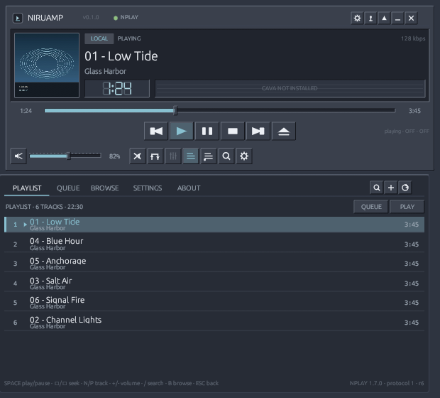

# NIRUAMP

**A Winamp-inspired Rust frontend for [NPLAY](https://github.com/nirucon/nplay), designed for the [NIRUX](https://github.com/nirucon/nirux) desktop.**

Compact, fast, resource-conscious and unmistakably classic Winamp in character:
a hardware-panel player deck, digital LED time, spectrum display, dense playlist
and driven by one authoritative NPLAY playback engine.



## Status

**0.1.0 — runnable, installable and integrated.** NIRUAMP is a Rust graphical
client, not a second player. [NPLAY](https://github.com/nirucon/nplay) **1.7.0 or
newer is required** and remains fully usable standalone.

The repository includes the frontend, the NPLAY headless service changes and
tests, protocol/architecture/testing documentation, an installer, desktop entry
and measured resource evidence. See [docs/VALIDATION.md](docs/VALIDATION.md) for
what was and was not live-tested on the build machine.

More screenshots: [light theme](docs/screenshots/main-light.png),
[search](docs/screenshots/search.png), [settings](docs/screenshots/settings.png).

## What works

- Winamp-style deck with original vector artwork, LED clock, seek/volume,
  grouped transport, shuffle/repeat, playlist and queue panels.
- Windowshade mode, always-on-top, custom compact titlebar, remembered geometry.
- Async federated search with stale-result protection: local, Navidrome,
  Sveriges Radio, YouTube, Spotify and custom radio when configured.
- Browse local artists/albums/folders, playlists, favorites, history, radio,
  provider albums/playlists/artists and Spotify devices.
- Queue play/add/remove/reorder/clear/save; local playlists; favorites; ratings;
  custom radio setup; drag-and-drop local media and streams.
- Artwork from NPLAY's existing cache, decoded off the UI thread, bounded cache.
- NIRUX appearance integration (all builtin themes, sparse custom themes and
  sparse `appearance.toml`) with live reload and a standalone classic fallback.
- Real CAVA visualization when available; an honest unavailable state otherwise.
- One backend session, one queue, one MPRIS owner and one statistics pipeline.

## Requirements

- Linux with X11 or XWayland. The UI uses `eframe`/`egui` with the Glow renderer.
- **NPLAY 1.7.0+** with its normal runtime prerequisites (`mpv`, Python 3).
- Rust 1.75+ to build.
- Optional: `cava` (visualization), `yt-dlp` (YouTube), `librespot` (Spotify
  local playback), Navidrome credentials, Spotify Premium for Connect playback.

## Install

```sh
git clone https://github.com/nirucon/niruamp.git
cd niruamp
./install.sh
niruamp
```

The installer builds a release binary, installs it to `~/.local/bin/niruamp`,
adds a desktop entry and a scalable original icon. It refuses to continue when
NPLAY is missing or older than 1.7.0; set `NIRUAMP_SKIP_NPLAY_CHECK=1` only for
packaging experiments.

```sh
./uninstall.sh          # keeps NIRUAMP preferences and all NPLAY data
./uninstall.sh --purge  # also removes NIRUAMP preferences/window state
```

NPLAY is never modified by the uninstaller.

## Run and connect

```sh
niruamp
```

NIRUAMP looks for `$XDG_RUNTIME_DIR/nplay/control.sock`, then starts the
installed `nplay --serve` automatically if no compatible service is running. A
second NIRUAMP launch activates the existing window instead of starting another
player. A GUI never stops a service it did not start, and an owned service is
stopped on normal GUI exit unless “Keep playing after GUI exit” is enabled (the
setting applies to the next service launch).

For a development backend checkout without installing NPLAY:

```sh
NPLAY_DEV_PATH=/path/to/nplay niruamp
```

Manual backend use:

```sh
nplay --serve
nplay --serve --service-socket /path/to/socket --idle-exit 25
```

## Controls

| Key | Action |
|---|---|
| Space | Play / pause |
| N / P | Next / previous |
| S | Stop |
| ← / → | Seek 5 s (Shift: 30 s) |
| + / - | Volume |
| M | Mute |
| R / H | Repeat / shuffle |
| / or Ctrl+F | Search |
| B | Browse |
| F | Favorite current track |
| 1–5 | Playlist / queue / browse / settings / about |
| W / T | Windowshade / always-on-top |
| ↑ / ↓ | Move selection |
| Alt+↑ / ↓ | Reorder queue |
| Delete | Remove selected queue item |
| Esc | Back / leave text field |

Shortcuts never steal typing from text fields. Right-click a track for queue,
playlist, favorite and detail actions. Drag local media onto the window to play
it; extra files are queued.

## Architecture

NIRUAMP is presentation and interaction only. NPLAY owns playback, providers,
queue, library, listening statistics, notifications and MPRIS. NPLAY 1.7.0 adds
a small versioned JSON-RPC service over a private Unix socket; both the terminal
UI and NIRUAMP consume the same controller.

- `src/app.rs` — application state, commands, lifecycle, keyboard and layout.
- `src/protocol.rs` — JSON-RPC client, framing and reconnect-safe event stream.
- `src/platform.rs` — backend discovery/spawn, ownership, single instance.
- `src/theme.rs` — NIRUX appearance resolution, builtin/custom themes, watcher.
- `src/views/` — deck, playlist/queue, browser and settings.
- `docs/ARCHITECTURE.md`, [docs/PROTOCOL.md](docs/PROTOCOL.md),
  [docs/TESTING.md](docs/TESTING.md).

The deck and playlist are attached panels in one window. This is deliberately
more reliable than juggling multiple native windows across WMs and keeps focus,
keyboard navigation and windowshade behavior coherent. It is not a pixel-for-pixel
275×116 reproduction: controls remain legible and clickable on modern displays.

## Appearance

By default NIRUAMP follows the active NIRUX theme:

1. `$XDG_CONFIG_HOME/niruwm/config.toml` selects the theme.
2. A custom `$XDG_CONFIG_HOME/niruwm/themes/NAME.toml` wins, exactly like NIRUX.
3. Otherwise the compiled builtin palette is used and a valid schema-1
   `appearance.toml` may override semantic roles plus font, spacing, focus width
   and reduced motion.
4. Invalid appearance files are ignored; a malformed custom theme is reported
   without replacing a working appearance.

Choose **Settings → Theme → NIRUAMP Classic** for the standalone fallback. Theme
and appearance changes apply live after a debounce.

## Honest limitations

- No equalizer: NPLAY exposes no EQ DSP for mpv, and Spotify is not routed
  through mpv. NIRUAMP does not draw a fake EQ.
- No legacy `.wsz` skin compatibility in this release; the character comes from
  original vector controls and live NIRUX theming.
- Visualization needs CAVA and the host audio capture path. When CAVA is absent
  or delivery stops, NIRUAMP shows a clear unavailable state rather than random
  bars. Live radio/YouTube visualization depends on what CAVA can capture.
- Live radio cannot seek; Spotify EQ and some source-specific operations remain
  backend limitations, surfaced as disabled states.
- There is no tray icon. “Keep playing” is an explicit NPLAY service ownership
  choice, not hidden background behavior.
- Navidrome/Spotify credentials and OAuth stay in NPLAY's `0600` secrets file.
  The GUI never reads or displays them.
- Live playback, accounts, CAVA and provider services were not available on the
  build host; automated tests use the real NPLAY controller with a deterministic
  mpv IPC harness, and the report states exactly which tests were live.

## Development and tests

```sh
cargo fmt --all -- --check
cargo clippy --all-targets -- -D warnings
cargo test
cargo build --release --locked
```

NPLAY service and regression tests (from the NPLAY repository):

```sh
python3 -m unittest discover -s tests -v
```

See [docs/TESTING.md](docs/TESTING.md) for the fake mpv/CAVA harness, lifecycle
matrix and Xvfb screenshot procedure, and [docs/VALIDATION.md](docs/VALIDATION.md)
for measured CPU/RSS, test machines and remaining gaps.

## License

MIT. Original artwork and icons are drawn in code. Independent project; not
affiliated with Winamp.
